  

# 🚛 Awesome Fleet & Transportation Management 🛰️

### Curated Directory of Telematics, VRP Route Optimization, Fleet ERP & GPS Tracking Solutions
**Comprehensive SaaS Benchmarks • Open-Source Codebases • Transparent Pricing • Technical Architecture**

*Last updated: March 2026*

---

## 📌 Table of Contents
- [🌐 Sector Overview & Market Dynamics](#-sector-overview--market-dynamics)
- [🏢 SaaS & Hosted Commercial Platforms](#-saas--hosted-commercial-platforms)
- [💻 Open-Source Transportation & Telematics Engines](#-open-source-transportation--telematics-engines)
- [🧭 Decision Matrix & Framework Selection](#-decision-matrix--framework-selection)
- [🤝 How to Contribute](#-how-to-contribute)
- [💖 Support & Sponsorship](#-support--sponsorship)
- [📈 Star History](#-star-history)
- [⚠️ Disclaimer](#️-disclaimer)

---

## 🌐 Sector Overview & Market Dynamics

The global **Fleet Management Software (FMS)** and **Intelligent Transportation Systems (ITS)** market is currently valued between **$10 Billion and $13 Billion**, expanding at a robust **14% to 19% CAGR** through the 2030s.

* **Market Structure & Consolidation**: The industry remains **moderately fragmented** across regional telematics vendors, localized logistics dispatch systems, and specialized niche software (e.g., fuel cards, maintenance apps, and camera-only safety stacks). However, rapid consolidation is actively underway: tier-1 telematics giants now control roughly **30%–35%** of global enterprise market share through steady acquisitions of computer vision, AI dashcam, EV fleet planning, and IoT hardware startups.
* **Commoditization vs. Differentiation**: Basic GPS vehicle tracking and breadcrumb trails have largely become commoditized. Leading enterprise providers compete on predictive maintenance, edge-AI dashcam driver coaching, automated IFTA/ELD regulatory compliance, and bidirectional API connectivity into enterprise ERP systems. Meanwhile, open-source routing and tracking stacks provide high-scale data sovereignty without per-asset monthly toll fees.

---

## 🏢 SaaS & Hosted Commercial Platforms

Below is a benchmark of leading commercial enterprise fleet management and telematics suites, sorted in descending order by **Company Size / Valuation**.

| Product | Company Size (Valuation / Revenue) | Pricing (Starting) | Free Tier / Trial Limits | Description |
|:---|:---|:---|:---|:---|
| **[Verizon Connect](https://www.verizonconnect.com/)** | **~$192B Market Cap** (Parent: Verizon; ~$1.6B segment revenue) | ~$20–$25/vehicle/month (3-year contract standard) | No free forever plan; demo-based trial/pilot arranged via sales consultation (typically up to 30 days upon inquiry) | Mature enterprise telematics suite with deep reporting, routing, and compliance tools. |
| **[Samsara](https://www.samsara.com/)** | **~$24B Market Cap** (~$1.8B ARR / FY26 revenue) | ~$27–$33/vehicle/month (Hardware separate; typically 3-year term) | No free forever plan; 30-day evaluation trial available upon request (hardware must be returned within 30 days) | All-in-one connected operations combining GPS tracking, AI dash cams, ELD compliance, and maintenance. |
| **[Zoho Transport](https://www.zoho.com/)** | **~$10B–$12.5B Est. Valuation** (Private; ~$1.5B revenue) | $8/user/month (Zoho Creator Standard, billed annually, or $12/user/month billed monthly) | No free forever tier for multi-user; 15-day free trial on Zoho Creator (full access to build/deploy fleet app template, no credit card required) | Fleet and transport management templates deployed within the Zoho Creator low-code cloud ecosystem. |
| **[Motive](https://gomotive.com/)** | **~$2.85B–$3.1B Valuation** (Private; ~$500M+ ARR) | ~$25/vehicle/month (Gateway ELD hardware ~$150; 12-month minimum contract) | No free forever plan for telematics; no standard public software trial (sales-assisted demos provided; 90-day trial for select Workforce Management add-on modules) | Trucking-focused platform with industry-leading ELD compliance, AI dash cams, and driver safety features. |
| **[Fleetio](https://www.fleetio.com/)** | **~$1.5B Valuation** (Private; ~$50M–$100M ARR) | $4/vehicle/month (Essential plan, billed annually, or $5/vehicle/month billed monthly) | No free forever plan; 14-day free trial (full access to core maintenance tracking, no credit card required) | Maintenance-focused fleet management with automated service tracking and integrations, without requiring proprietary hardware. |
| **[Geotab](https://www.geotab.com/)** | **>$1B Unicorn Valuation** (Private; ~$1B+ annual revenue) | ~$10–$15/vehicle/month for base software tier (~$30–$40/vehicle/month bundled with GO hardware via resellers) | No free forever plan; no self-serve free trial (custom pilot/trial programs and live demos coordinated directly through authorized resellers) | Open-ecosystem telematics connecting 5M+ vehicles worldwide with 200+ third-party marketplace integrations. |

---

## 💻 Open-Source Transportation & Telematics Engines

Self-hosted platforms, routing calculation engines, and fleet ERP modules sorted by **GitHub Star Count** (descending). Each star badge links directly to the respective repository's stargazers list.

| Project | GitHub Stars | Architecture / Stack | Primary Focus & Capabilities |
|:---|:---|:---|:---|
| **[OSRM Backend](https://github.com/Project-OSRM/osrm-backend)** |  | C++20 / OpenStreetMap | **High-performance routing engine.** Delivers sub-millisecond point-to-point routing, distance/duration table calculations, map-matching, and trip planning at global scale. |
| **[Traccar](https://github.com/traccar/traccar)** |  | Java / Modern Web UI / SQL | **The premier open-source GPS tracking platform.** Supports **200+ GPS communication protocols and 2,000+ hardware models**. Features real-time telemetry, geofencing, driver behavior monitoring, and Docker Compose deployment. |
| **[GraphHopper](https://github.com/graphhopper/graphhopper)** |  | Java / OpenStreetMap | **Fast memory-efficient routing engine.** Handles turn-by-turn navigation, isochrone generation, and matrix calculations with flexible vehicle weighting (truck, car, bike). |
| **[OpenRemote](https://github.com/openremote/openremote)** |  | Java / TypeScript / Docker | **100% open-source IoT device management & telematics platform.** Ideal for connected vehicle fleets, EV charging station management, asset tracking, and geo-fenced smart rules engines. |
| **[OpenRouteService](https://github.com/GIScience/openrouteservice)** |  | Java / Spring Boot | **Spatial routing API and analytics suite.** Provides vehicle route optimization, reachable area (isochrone) calculations, matrix services, and integration with OpenStreetMap data. |
| **[VROOM](https://github.com/VROOM-Project/vroom)** |  | C++20 / REST API | **Vehicle Routing Optimization Machine (VRP solver).** Solves complex Vehicle Routing Problems (TSP, CVRP, VRPTW, pickup-and-delivery) in milliseconds using matrices from OSRM or OpenRouteService. |
| **[pgRouting](https://github.com/pgRouting/pgrouting)** |  | C / C++ / PostGIS / PostgreSQL | **Geospatial routing database extension.** Extends PostGIS and PostgreSQL to provide Dijkstra, A*, Floyd-Warshall, and traveling salesperson routing algorithms directly inside the relational database. |
| **[Traccar Client](https://github.com/traccar/traccar-client)** |  | Java / Kotlin / Android | **Mobile tracking agent.** Transforms smartphones and mobile tablets into dedicated GPS tracking beacons that seamlessly transmit location and battery telemetry to self-hosted Traccar servers. |
| **[JT Vehicle Platform](https://github.com/liuxiaoyan199701-coder/jt-vehicle-platform)** |  | Spring Boot / Netty / Vue.js | **Standard commercial telematics & video monitoring platform.** Implements JT/T 808 and JT/T 1078 protocols for real-time location streaming, driver surveillance, and video dashcam playback. |
| **[VSD Fleet Management System](https://github.com/navariltd/Fleet-Management-System)** |  | Python / Frappe / ERPNext | **Complete ERP-native fleet operational suite.** Manages cargo manifest intake, vehicle dispatch, fuel disbursement approvals, repair workflows, and accounting journal entries. |
| **[sachnaror/fleet-management-system](https://github.com/sachnaror/fleet-management-system)** |  | FastAPI / Python / PostgreSQL | **Diagnostic telematics service.** Decodes **600+ DTC OBD-II / CAN bus diagnostic error codes**, telemetry ingest, speed anomaly triggers, and automated alert rules. |
| **[Mobo Fleet](https://github.com/mobo-open-source/mobo_fleet)** |  | Flutter / Dart / Odoo JSON-RPC | **Mobile fleet management app for Odoo ERP.** Cross-platform mobile application providing driver logging, vehicle service history, fuel records, and biometric user access. |
| **[SmartFleet](https://github.com/vinnudev/Smart-Fleet-Telematics-Vehicle-Monitoring-System)** |  | Django / DRF / Leaflet.js | **Full-stack telematics dashboard.** Starter architecture for vehicle tracking maps, VIN-indexed telemetry, and alerting endpoints. |

---

## 🧭 Decision Matrix & Framework Selection

* **For Turnkey GPS Tracking & Device Support**: Deploy **[Traccar](https://github.com/traccar/traccar)**. It is the gold standard for vendor-neutral hardware communication, running reliably across low-spec virtual machines or Docker clusters.
* **For Dispatch, Logistics Optimization & VRP**: Combine **[OSRM](https://github.com/Project-OSRM/osrm-backend)** or **[OpenRouteService](https://github.com/GIScience/openrouteservice)** with **[VROOM](https://github.com/VROOM-Project/vroom)** to solve multi-vehicle pickup-and-delivery route scheduling problems in milliseconds.
* **For End-to-End Enterprise Accounting & Vehicle Operations**: Deploy **[VSD Fleet Management System](https://github.com/navariltd/Fleet-Management-System)** if you are standardizing on ERPNext/Frappe, or **[Mobo Fleet](https://github.com/mobo-open-source/mobo_fleet)** for Odoo environments.
* **For IoT & Mixed Smart Fleet Infrastructure**: Deploy **[OpenRemote](https://github.com/openremote/openremote)** for unified fleet assets, EV chargers, and automated geofencing logic.
* **For Commercial ELD Mandate & Hardware Bundling**: Turnkey SaaS platforms (**[Samsara](https://www.samsara.com/)**, **[Motive](https://gomotive.com/)**, **[Verizon Connect](https://www.verizonconnect.com/)**) remain standard where certified FMCSA electronic logging devices, AI-backed road camera liability shields, and dedicated 24/7 road-side support are legally required.

---

## 🤝 How to Contribute

Contributions are welcome and appreciated! Help keep this curated landscape up to date:

1. 🍴 **Fork** this repository.
2. 🌿 Create a branch for your addition (`git checkout -b feature/add-new-fleet-tool`).
3. 📝 Add your tool or library following the existing markdown schema:
   - Provide an accurate description, stack details, and official URL.
   - For SaaS products, verify specific starting prices and explicit trial terms.
   - For open-source projects, ensure the GitHub repository link and star badge are present.
4. 🚀 Open a **Pull Request** detailing why the tool belongs in this curated collection.

---

## 💖 Support & Sponsorship

If this curated repository saved you time, informed your engineering architecture, or helped your transportation business make better software decisions, please consider supporting the project:

- ⭐ **Star this repository** to improve visibility on GitHub!
- 🍴 **Fork and share** with fellow logistics engineers and fleet directors!
- ☕ **Buy me a coffee / Sponsor**: Support ongoing maintenance directly on the [GitHub Sponsor Dashboard](https://github.com/sponsors/ishandutta2007). Your support helps keep these benchmarks and open-source lists fresh and actively maintained!

---

## 📈 Star History

---

## ⚠️ Disclaimer

- This curated collection is maintained for informational and educational purposes only. Mention of vendors or projects does not constitute a commercial endorsement.
- Fleet telematics systems ingest driver biometric, location, and operational data; ensure your implementation satisfies pertinent privacy frameworks (such as GDPR, CCPA, and FMCSA regulatory rules for hours of service / ELD).
- Always benchmark your specific dispatch constraints, device protocols, and volume requirements before making production architectural commitments.
